# Data Model — Talento MX Platform

> PostgreSQL 16 · snake_case · all tables have `id uuid PK default gen_random_uuid()`, `created_at`, `updated_at` (omitted below for brevity). Soft delete via `deleted_at` on person-related tables. Money as `numeric(12,2)` MXN. Enums shown inline.
>
> Companion to [SPEC.md](./SPEC.md) §3–§4. Status: draft v1 · 2026-08-27

## Design principles

1. **One person, one record.** `person` is the shared-core identity. Being a candidate or staff is a *role in time*, not a different table — this is what makes "Convertir a Personal" a cheap operation: the expediente (documents) hangs off `person`, so nothing moves.
2. **Client-scoped visibility.** Every row a Guest can see traces to a `client_id`; RLS policies filter by the client bound to the session's user.
3. **Pre-payroll is derived, then frozen.** `payroll_line` rows are computed from attendance + incidents, but once a period closes they are snapshotted (no recomputation of history when a salary changes).
4. **Documents are a checklist against a template.** What's *required* lives in `document_template_item` (per job type); what's *delivered* lives in `person_document`. Completeness % = delivered/required, computed, never stored.

## ER Diagram

```mermaid
erDiagram
    app_user {
        uuid id PK
        text firebase_uid UK
        text email
        enum role "admin|recruiter|supervisor|payroll|guest"
        uuid person_id FK "nullable"
        bool active
    }
    person {
        uuid id PK
        text first_name
        text last_name_paterno
        text last_name_materno
        char18 curp UK "nullable"
        varchar13 rfc UK "nullable"
        varchar11 nss "nullable"
        date birth_date
        text phone
        text whatsapp
        text email
        text address_text
        text zone
        enum lifecycle "candidate|hired|active_staff|inactive"
        enum source "bolsa|referral|social|direct|other"
        timestamptz deleted_at
    }
    client {
        uuid id PK
        text name
        text legal_name
        text rfc
        enum_arr lines "recruiting|services"
        text billing_notes
        bool active
    }
    client_contact {
        uuid id PK
        uuid client_id FK
        text name
        text email
        text phone
        text role_title
    }
    site {
        uuid id PK
        uuid client_id FK
        text name
        text address_text
        point geo "nullable"
        bool active
    }
    guest_access {
        uuid id PK
        uuid app_user_id FK
        uuid client_id FK
        uuid invited_by FK
        text magic_link_token_hash
        timestamptz expires_at
        timestamptz revoked_at
    }
    document_type {
        uuid id PK
        text code UK "rfc|curp|acta_nacimiento|nss|ine|..."
        text name_es
        bool has_expiry
        text validation_regex "nullable"
    }
    document_template {
        uuid id PK
        text name
        text notes
    }
    document_template_item {
        uuid id PK
        uuid template_id FK
        uuid document_type_id FK
        bool required
    }
    person_document {
        uuid id PK
        uuid person_id FK
        uuid document_type_id FK
        text storage_path "GCS"
        enum status "pendiente|entregado|rechazado|vencido"
        text rejection_reason
        date issued_at
        date expires_at
        uuid reviewed_by FK
    }
    job_opening {
        uuid id PK
        uuid client_id FK
        text title
        text description
        int vacancies
        numeric salary_min
        numeric salary_max
        uuid document_template_id FK
        enum status "abierta|pausada|cerrada"
        date target_fill_date
        uuid recruiter_id FK
    }
    candidacy {
        uuid id PK
        uuid person_id FK
        uuid job_opening_id FK
        enum stage "postulado|filtro|entrevista_rh|entrevista_cliente|documentacion|oferta|contratado|rechazado|retirado"
        text rejection_reason
        uuid recruiter_id FK
        text anonymized_summary
    }
    stage_transition {
        uuid id PK
        uuid candidacy_id FK
        enum from_stage
        enum to_stage
        uuid moved_by FK
        text note
        timestamptz moved_at
    }
    interview {
        uuid id PK
        uuid candidacy_id FK
        enum stage
        timestamptz scheduled_at
        text interviewer_name
        enum mode "presencial|video|telefono"
        enum outcome "pendiente|aprobada|rechazada|no_show"
        text notes
    }
    opening_comment {
        uuid id PK
        uuid job_opening_id FK
        uuid author_user_id FK
        text body
        bool visible_to_guest
    }
    staff_profile {
        uuid id PK
        uuid person_id FK "unique"
        uuid hired_from_candidacy_id FK "nullable — the conversion link"
        text job_title
        numeric base_salary
        enum pay_schedule "semanal|quincenal"
        varchar18 clabe
        date hired_at
        date terminated_at
        text equipment_notes
    }
    service_job {
        uuid id PK
        uuid site_id FK
        enum type "limpieza|mantenimiento|temporal"
        text title
        date scheduled_date
        time start_time
        time end_time
        text recurrence "rrule, nullable"
        enum status "programado|en_curso|completado|cancelado"
        uuid supervisor_id FK
        text notes
    }
    assignment {
        uuid id PK
        uuid service_job_id FK
        uuid staff_profile_id FK
    }
    attendance_record {
        uuid id PK
        uuid assignment_id FK
        date date
        enum status "presente|retardo|falta|permiso|incapacidad"
        int minutes_late "nullable"
        text note
        uuid captured_by FK
        timestamptz captured_at
        bool synced_offline
    }
    incident {
        uuid id PK
        uuid staff_profile_id FK
        uuid client_id FK
        enum type "falta|retardo|horas_extra|bono|descuento|prestamo"
        date date
        numeric amount "nullable"
        numeric hours "nullable"
        uuid reported_by FK
        enum status "pendiente|aprobada|rechazada"
        uuid reviewed_by FK
        uuid payroll_line_id FK "nullable — set when settled"
    }
    payroll_period {
        uuid id PK
        text label
        enum schedule "semanal|quincenal"
        date starts_on
        date ends_on
        text scope_note
        enum status "borrador|cerrado"
        uuid closed_by FK
        timestamptz closed_at
    }
    payroll_line {
        uuid id PK
        uuid payroll_period_id FK
        uuid staff_profile_id FK
        numeric base_salary
        numeric overtime_amount
        numeric bonus_amount
        numeric deduction_amount
        numeric absence_deduction
        numeric net_amount
        jsonb detail "per-incident breakdown"
    }
    notification {
        uuid id PK
        uuid app_user_id FK
        enum kind "doc_por_vencer|entrevista|asistencia_faltante|periodo_por_cerrar|comentario_cliente"
        jsonb payload
        timestamptz read_at
    }
    audit_log {
        uuid id PK
        uuid actor_user_id FK
        text entity
        uuid entity_id
        text action
        jsonb diff
        timestamptz at
    }

    client ||--o{ client_contact : has
    client ||--o{ site : has
    client ||--o{ job_opening : posts
    client ||--o{ guest_access : grants

    app_user ||--o| person : "may link"
    app_user ||--o{ guest_access : "guest scope"
    app_user ||--o{ notification : receives
    app_user ||--o{ audit_log : acts

    person ||--o{ person_document : "expediente"
    person ||--o{ candidacy : "applies as"
    person ||--o| staff_profile : "when hired"

    document_template ||--o{ document_template_item : contains
    document_type ||--o{ document_template_item : "required in"
    document_type ||--o{ person_document : "instance of"

    job_opening }o--|| document_template : requires
    job_opening ||--o{ candidacy : receives
    job_opening ||--o{ opening_comment : "guest thread"

    candidacy ||--o{ stage_transition : history
    candidacy ||--o{ interview : schedules
    candidacy |o--o| staff_profile : "hired_from"

    staff_profile ||--o{ assignment : "works at"
    site ||--o{ service_job : hosts
    service_job ||--o{ assignment : "crewed by"
    assignment ||--o{ attendance_record : logs

    staff_profile ||--o{ incident : accrues
    client ||--o{ incident : "at client"

    payroll_period ||--o{ payroll_line : contains
    staff_profile ||--o{ payroll_line : "paid via"
    incident }o--o| payroll_line : "settled in"
```

## Tables

### Shared core

**`app_user`** — login identity (mirrors Firebase Auth uid).
`firebase_uid text unique` · `email` · `role enum(admin, recruiter, supervisor, payroll, guest)` · `person_id uuid FK null` (internal users who are also staff) · `active bool`

**`person`** — the single identity for candidates and staff.
`first_name` · `last_name_paterno` · `last_name_materno` · `curp char(18) unique null` · `rfc varchar(13) unique null` · `nss varchar(11) null` · `birth_date` · `phone` · `whatsapp` · `email` · `address_text` · `zone` · `lifecycle enum(candidate, hired, active_staff, inactive)` · `source enum(bolsa, referral, social, direct, other)` · `deleted_at`
Indexes: `curp`, `rfc`, trigram on names (duplicate detection).

**`client`** — companies served by either business line.
`name` · `legal_name` · `rfc` · `lines enum` · `billing_notes` · `active`

**`client_contact`** — `client_id FK` · `name` · `email` · `phone` · `role_title`

**`site`** — physical locations where services happen. `client_id FK` · `name` · `address_text` · `geo point null` · `active`

**`guest_access`** — what a guest user can see. `app_user_id FK` · `client_id FK` · `invited_by FK app_user` · `magic_link_token_hash` · `expires_at` · `revoked_at`

### Documents (expediente)

**`document_type`** — catalog. `code unique` (rfc, curp, acta_nacimiento, nss, ine, comprobante_domicilio, clabe, antecedentes, estudios, recomendacion…) · `name_es` · `has_expiry bool` · `validation_regex null` (e.g. CURP/RFC format)

**`document_template`** — named checklist per job type. `name` ("Operativo limpieza", "Ejecutivo") · `notes`

**`document_template_item`** — `template_id FK` · `document_type_id FK` · `required bool`

**`person_document`** — a delivered document. `person_id FK` · `document_type_id FK` · `storage_path` (GCS) · `status enum(pendiente, entregado, rechazado, vencido)` · `rejection_reason` · `issued_at` · `expires_at` · `reviewed_by FK app_user` · unique `(person_id, document_type_id)`
> Access to `storage_path` only via signed URLs; every read logged in `document_access_log` (`person_document_id`, `app_user_id`, `accessed_at`).

### Recruiting

**`job_opening`** — `client_id FK` · `title` · `description` · `vacancies int` · `salary_min/max` · `document_template_id FK` · `status enum(abierta, pausada, cerrada)` · `target_fill_date` · `recruiter_id FK app_user`

**`candidacy`** — a person applying to one opening. `person_id FK` · `job_opening_id FK` · `stage enum(postulado, filtro, entrevista_rh, entrevista_cliente, documentacion, oferta, contratado, rechazado, retirado)` · `rejection_reason` · `recruiter_id FK` · `anonymized_summary text` (what the guest sees pre-interview) · unique `(person_id, job_opening_id)`

**`stage_transition`** — audit of pipeline moves. `candidacy_id FK` · `from_stage` · `to_stage` · `moved_by FK app_user` · `note` · `moved_at`

**`interview`** — `candidacy_id FK` · `stage` · `scheduled_at` · `interviewer_name` · `mode enum(presencial, video, telefono)` · `outcome enum(pendiente, aprobada, rechazada, no_show)` · `notes`

**`opening_comment`** — guest ↔ recruiter thread. `job_opening_id FK` · `author_user_id FK` · `body` · `visible_to_guest bool`

### Professional Services

**`staff_profile`** — employment data for a hired person. `person_id FK unique` · `hired_from_candidacy_id FK null` (the conversion link!) · `job_title` · `base_salary numeric` · `pay_schedule enum(semanal, quincenal)` · `clabe varchar(18)` · `hired_at` · `terminated_at` · `equipment_notes`

**`service_job`** — a scheduled service. `site_id FK` · `type enum(limpieza, mantenimiento, temporal)` · `title` · `scheduled_date` · `start_time` · `end_time` · `recurrence rrule text null` (materialized into rows by a job) · `status enum(programado, en_curso, completado, cancelado)` · `supervisor_id FK app_user` · `notes`

**`assignment`** — staff on a service job. `service_job_id FK` · `staff_profile_id FK` · unique pair

**`attendance_record`** — one per assignment per day. `assignment_id FK` · `date` · `status enum(presente, retardo, falta, permiso, incapacidad)` · `minutes_late int null` · `note` · `captured_by FK app_user` · `captured_at` · `synced_offline bool`

**`incident`** — pre-payroll feed. `staff_profile_id FK` · `client_id FK` · `type enum(falta, retardo, horas_extra, bono, descuento, prestamo)` · `date` · `amount numeric null` (null for falta/retardo — valued at payroll time) · `hours numeric null` · `reported_by FK app_user` · `status enum(pendiente, aprobada, rechazada)` · `reviewed_by FK` · `payroll_line_id FK null` (set when settled)

### Pre-payroll

**`payroll_period`** — `label` · `schedule enum(semanal, quincenal)` · `starts_on` · `ends_on` · `scope_note` ("Cuadrillas Mérida") · `status enum(borrador, cerrado)` · `closed_by FK` · `closed_at`

**`payroll_line`** — one row per staff per period, **snapshotted at close**. `payroll_period_id FK` · `staff_profile_id FK` · `base_salary` · `overtime_amount` · `bonus_amount` · `deduction_amount` · `absence_deduction` · `net_amount` · `detail jsonb` (per-incident/attendance breakdown for the expandable row) · unique `(payroll_period_id, staff_profile_id)`

### Cross-cutting

**`notification`** — `app_user_id FK` · `kind enum(doc_por_vencer, entrevista, asistencia_faltante, periodo_por_cerrar, comentario_cliente)` · `payload jsonb` · `read_at`
**`audit_log`** — generic `actor_user_id` · `entity` · `entity_id` · `action` · `diff jsonb` · `at` (required for LFPDPPP posture)

## The conversion flow, in data terms

1. `candidacy.stage → contratado` (+ `stage_transition` row)
2. Create `staff_profile` with `person_id` and `hired_from_candidacy_id`
3. `person.lifecycle → active_staff`
4. Nothing happens to documents — `person_document` already belongs to the person. UI shows "Expediente transferido" but it's a no-op by design.

## Open modeling questions

1. Multi-site staff: can one person be assigned to overlapping service jobs? (current model allows; add exclusion constraint if not)
2. Préstamos: simple incident vs amortization schedule across periods? (v1: manual incidents per period)
3. Do clients of the *recruiting* line ever need site-level scoping, or is client-level enough? (v1: client-level)
4. Retention policy for documents of rejected candidates (LFPDPPP): auto-purge after N months?
