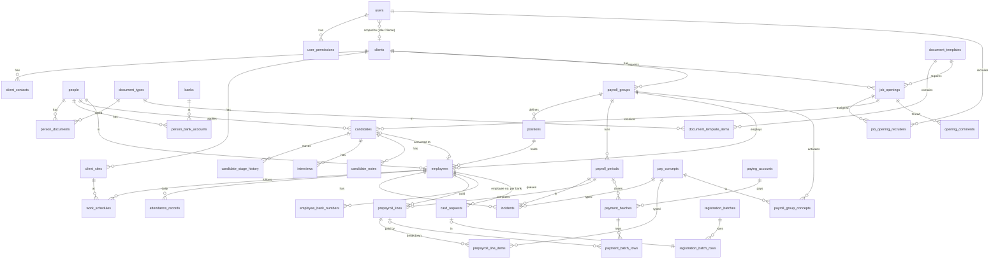

# DATA MODEL — Plataforma de Reclutamiento y Prenómina

> **Database:** PostgreSQL 18 (any Postgres reachable over TCP — managed or a container) · **ORM:** EF Core 10 (Npgsql) with migrations as the only way to change DDL, owned by `services/platform-api` · **Schema:** one, `platform` (the API owns its migrations); the sections below (`core`, `recruiting`, `payroll`, `bank`, `audit`) are **modules** of that API, not Postgres schemas — see ARCHITECTURE §2
> **Companion docs:** [SPEC.md](./SPEC.md) · [ARCHITECTURE.md](./ARCHITECTURE.md)
> **Conventions:** English identifiers, `snake_case` in SQL / `PascalCase` in C# (EF naming convention `UseSnakeCaseNamingConvention`) / `camelCase` in the generated TypeScript. Every table has `id bigint generated always as identity` (internal, never exposed) and `uid uuid not null unique default gen_random_uuid()`; every foreign key references `uid`; the API returns `uid` as `id`. Column lines below written as `… | uuid FK …` mean "uuid referencing that table's `uid`". Business codes (`legacy_code`, `short_name`, `spei_code`) are unique columns. Names people type and pick from (zones per state, the recruiting puestos catalog, education levels, benefits, document templates, a client's sites) are unique **ignoring capitals**: a unique index on `lower(name)` (migration `CaseInsensitiveNames`, D-021); `lower()` follows the database locale, `en_US.utf8`, so accented capitals fold too. Every table has `created_at / created_by / updated_at / updated_by` stamped by the API; soft delete only where stated (`deleted_at`). Typed and payable money is `numeric(12,2)`, rates `numeric(12,4)`; **computed pre-payroll amounts** (`prepayroll_line_items.amount`, `prepayroll_lines.gross_earnings / total_deductions / total_net_exact`) are `numeric(18,6)`: each item is calculated exactly and stored cut (truncated) to 6 decimals, the line sums are sums of those stored items — never rounded; the payable `total_net` is `truncate(total_net_exact, 2)` (PLAN D42); never `float`/`real`; on the wire money is a decimal **string**; on the server it is `decimal` (`Platform.Payroll.Engine`), never `double`. Timestamps are `timestamptz`; business dates are `date` keys (`yyyy-MM-dd`) computed on the server in the payroll group's IANA time zone (`payroll_groups.time_zone`, default `America/Monterrey`), never from the server's UTC clock. Nested value objects (e.g. a bank batch's fixed header snapshot) may be `jsonb` mapped to an owned C# record (and the matching generated TS type); anything queried or joined is rows. Derived data (statuses, counters, totals, prepayroll lines) is server-only and written in the same transaction as the change that causes it; the API ignores it if a client sends it.

---

## 1. Overview



Module ownership (all tables live in Postgres schema `platform`, migrated by `platform-api`; the module is the folder in the API and the prefix used in this document):

| Module | Tables |
|---|---|
| `core` | users, user_permissions, clients, client_contacts, client_sites, people, person_documents, person_bank_accounts, document_types, document_templates, document_template_items, banks, catalogs (zones, positions_catalog, education_levels, benefits, sources, holidays), notifications |
| `recruiting` | job_openings, job_opening_events, job_opening_recruiters, candidates, candidate_stage_history, candidate_notes, interviews, opening_comments |
| `payroll` | payroll_groups, positions, payroll_group_concepts, pay_concepts, employees, employee_bank_numbers, card_requests, work_schedules, attendance_records, attendance_unlocks, incidents, payroll_periods, prepayroll_lines, prepayroll_line_items |
| `bank` | paying_accounts, payment_batches, payment_batch_rows, manual_payments, registration_batches, registration_batch_rows |
| `audit` | audit_log, data_access_log |

---

## 2. Enumerations (PostgreSQL `enum` types, labels shown in UI in Spanish)

| Enum | Values |
|---|---|
| `user_role` | `administrator`, `recruiter`, `client` |
| `permission_module` | `recruiting`, `recruiting_reports`, `payroll_prepayroll`, `payroll_attendance`, `payroll_incidents`, `payroll_staff`, `payroll_payment_files`, `payroll_card_requests`, `users` |
| `gender` | `male`, `female`, `unspecified` |
| `document_status` | `pending`, `delivered`, `validated`, `rejected`, `expired` |
| `bank_account_type` | `own_account` (1), `debit_card` (3), `clabe` (40) — numeric codes used by the Azteca layout |
| `opening_status` | `open`, `in_progress`, `filled`, `cancelled`, `paused` |
| `opening_priority` | `high`, `medium`, `low` |
| `candidate_stage` | `new`, `contacted`, `interview`, `suitable`, `not_suitable`, `hired`, `discarded` |
| `interview_outcome` | `pending`, `attended`, `no_show` |
| `opening_event_kind` | `created`, `edited`, `status_changed`, `recruiter_assigned`, `recruiter_removed`, `lead_changed` |
| `candidate_source` | `facebook`, `linkedin`, `whatsapp`, `referral`, `job_board`, `other` |
| `employee_status` | `active`, `vacation`, `sick_leave`, `suspended`, `terminated` — current value, derived from `employee_status_periods` |
| `period_type` | `weekly`, `biweekly` |
| `period_status` | `capturing`, `in_review`, `paid` — see §5.10; no "calculated"/"closed": the grid recomputes live and generating the payment file is the close |
| `attendance_status` | `present`, `partial`, `absent`, `rest_day`, `rest_day_worked`, `holiday`, `holiday_worked`, `sick_leave`, `leave_paid`, `leave_unpaid`, `vacation` |
| `concept_kind` | `earning`, `deduction` |
| `concept_calc` | `fixed_amount`, `qty_times_hourly_rate`, `qty_times_hourly_rate_x2`, `qty_times_hourly_rate_x3`, `qty_times_daily_salary_x2`, `percent_of_daily_salary`, `per_day_worked`, `manual` |
| `batch_status` | `generated`, `uploaded_to_bank`, `completed`, `cancelled` |
| `payment_row_status` | `ready`, `missing_account`, `invalid_account`, `pending`, `paid`, `rejected` |
| `card_request_status` | `queued`, `in_batch`, `uploaded`, `received`, `cancelled` |
| `payment_batch_kind` | `period_payment`, `pending_payment`, `frequent_accounts` |
| `registration_bank` | `banorte`, `banregio` |
| `document_template_scope` | `candidate`, `employee` |
| `payment_type` | `spei` (1), `tef` (2), `baz_transfer` (3) |
| `manual_payment_method` | `cash`, `check`, `other` — how a line was paid outside the bank files (PLAN D94) |
| `notification_kind` | `document_expiring`, `document_uploaded`, `opening_idle`, `attendance_missing`, `period_ready`, `user_invited`, `comment_posted` |

---

## 3. Module `core`

### 3.1 `users`

| Column | Type | Notes |
|---|---|---|
| id / uid | bigint identity / uuid UNIQUE | internal PK / public id |
| auth_uid | text UNIQUE NOT NULL | subject returned by `AuthProvider.verify(token)` (Firebase Auth today); the only place the provider leaks in |
| email | citext UNIQUE NOT NULL | |
| display_name | text NOT NULL | |
| phone | text | |
| role | user_role NOT NULL | roles live here, never in token claims; the client reads them from `GET /v1/me` |
| client_id | uuid FK clients | required when role = `client`, NULL otherwise (CHECK) |
| mfa_required | boolean default false | owner can force |
| mfa_secret_enc, mfa_enabled_at, mfa_last_step, mfa_failed_attempts, mfa_locked_until | | the TOTP secret (encrypted), when it was turned on, the last code's step (a code is good once), the wrong-code count and lock (PLAN D89, E16); `mfa_recovery_codes(user_id, code_hash, used_at)` and `mfa_sessions(user_id, auth_time, verified_at)` beside it |
| is_active | boolean default true | |
| last_login_at | timestamptz | |
| invited_at / accepted_at | timestamptz | |

### 3.2 `user_permissions`

Delegated grants for `administrator` users (SPEC §2.2).

| Column | Type | Notes |
|---|---|---|
| user_id | uuid FK users | |
| module | permission_module | |
| client_id | uuid FK clients NULL | NULL = all clients |
| UNIQUE | (user_id, module, client_id) NULLS NOT DISTINCT | PostgreSQL 15+; same effect as the expression index on `COALESCE(client_id, …)`, so one all-clients grant per module |

### 3.3 `clients`

| Column | Type | Notes |
|---|---|---|
| id / uid | bigint identity / uuid UNIQUE | internal PK / public id |
| short_name | text UNIQUE NOT NULL | "ECOVIA", "HEB" — what the owner uses |
| legal_name | text | razón social |
| rfc | text | 12/13 chars |
| uses_recruiting | boolean default false | set true when created from Reclutamiento or when the first `job_opening` is created; never asked in the UI |
| uses_payroll | boolean default false | set true when created from Nómina or when the first `payroll_group` is created; never asked in the UI |

The client has no zone column: lists show the zone of its first active site (PLAN D68, P7).
| notes | text | |
| is_active | boolean default true | |

### 3.4 `client_contacts`

| Column | Type | Notes |
|---|---|---|
| id / uid | bigint identity / uuid UNIQUE | internal PK / public id |
| client_id | uuid FK | |
| full_name, email (citext), phone, job_title | text | |
| user_id | uuid FK users NULL | set when invited to the Clients app |
| is_primary | boolean | |

### 3.5 `client_sites`

| Column | Type | Notes |
|---|---|---|
| id / uid | bigint identity / uuid UNIQUE | internal PK / public id |
| client_id | uuid FK | |
| name | text NOT NULL | "Oficinas Mitras", "Estación Ecovía Centro" |
| zone_id | uuid FK zones | municipio |
| street, ext_number, neighborhood, postal_code, municipality, state | text | |
| is_active | boolean | |

### 3.6 `people`

The shared registry. Columns were chosen so every bank layout can be produced without re-capture.

| Column | Type | Notes |
|---|---|---|
| id / uid | bigint identity / uuid UNIQUE | internal PK / public id |
| first_names | text NOT NULL | "CESAR EDUARDO" |
| last_name_paternal | text NOT NULL | |
| last_name_maternal | text | |
| full_name | text GENERATED | `paternal ‖ ' ' ‖ maternal ‖ ' ' ‖ first_names` — matches the Excel "APELLIDOS NOMBRES" order |
| birth_date | date | |
| birth_state | text | Banregio list ("NUEVO LEON", "COAHUILA", …) |
| gender | gender default `unspecified` | |
| is_foreign | boolean default false | "EXTRANJERO" comment; Banorte rejects foreign-born CURP |
| curp | text UNIQUE (partial, where not null) | 18 chars, regex CHECK `^[A-Z]{4}\d{6}[HM][A-Z]{5}[A-Z0-9]\d$` |
| rfc | text UNIQUE (partial) | 13 chars for persons |
| nss | text | 11 digits |
| mobile_phone | text | 10 digits CHECK |
| email | citext | |
| street, ext_number, neighborhood, postal_code (5), municipality, state | text | |
| source | candidate_source | how the person first reached us |
| notes | text | |
| privacy_notice_accepted_at | timestamptz | when the person accepted the aviso de privacidad in the Candidates app (ARCHITECTURE §6, PLAN D77) |
| deleted_at | timestamptz | soft delete (LFPDPPP erasure handled by anonymization job) |

Indexes: `(curp)`, `(rfc)`, trigram on `full_name`, `(mobile_phone)`.

### 3.7 `person_bank_accounts`

| Column | Type | Notes |
|---|---|---|
| id / uid | bigint identity / uuid UNIQUE | internal PK / public id |
| person_id | uuid FK | |
| bank_id | uuid FK banks | |
| account_type | bank_account_type | drives length validation: debit_card 16, clabe 18, own_account 14/20 |
| account_number_enc | bytea NOT NULL | AES-256-GCM in the API (`AesGcm`, key from env `ENCRYPTION_KEY`, key id prefix for rotation); decrypted only in the bank-file writers |
| account_last4 | text NOT NULL | for display `•••• 4562` |
| holder_name | text NOT NULL ≤ 40 | titular — defaults to the person's `full_name`; may be a third party (spouse, relative). Goes into the Azteca file as NOMBRE DEL BENEFICIARIO |
| alias | text | "Tarjeta Azteca", "Cuenta de mi esposa" |
| is_primary | boolean | one primary per person (partial unique index); the pay goes here |
| is_frequent_account_registered | boolean default false | set after the cuentas frecuentes file is confirmed uploaded |
| valid_from / valid_to | date | history: "CAMBIO DE CUENTA BANORTE" |

### 3.8 `banks`

| Column | Type | Notes |
|---|---|---|
| id / uid | bigint identity / uuid UNIQUE | internal PK / public id |
| name | text | "Banorte" |
| spei_code | text UNIQUE | "072" (Banxico 3-digit) |
| supports_registration | registration_bank NULL | banorte / banregio |
| supports_massive_payment | boolean | Azteca |
| is_active | boolean | |

Seed: 002 Banamex, 012 BBVA, 014 Santander, 019 Banjército, 021 HSBC, 030 Bajío, 036 Inbursa, 042 Mifel, 044 Scotiabank, 058 Banregio, 059 Invex, 060 Bansí, 062 Afirme, 072 Banorte, 127 Azteca, 137 BanCoppel, 646 STP, 722 Mercado Pago, …

### 3.9 `document_types`, `document_templates`, `document_template_items`

```
document_types(id, code UNIQUE, name_es, has_expiry bool, default_validity_days int NULL, sort_order, is_active)
document_templates(id, name_es UNIQUE (ignoring capitals), scope document_template_scope, is_default bool)   -- one default per scope (partial unique index)
document_template_items(id, template_id FK, document_type_id FK, is_required bool, UNIQUE(template_id, document_type_id))
```

`default_validity_days` only when `has_expiry` (CHECK). Reference rows (13 types, a default template per scope) are inserted by the S3 migration (`ReferenceDataSql`), never overwritten afterwards.

Seed codes: `INE`, `CURP`, `RFC`, `NSS`, `ACTA_NAC`, `DOMICILIO`, `ESTUDIOS`, `CUENTA_BANCO`, `ANTECEDENTES`, `RECOMENDACION`, `CV`, `FOTO`, `CONTRATO`.

### 3.10 `person_documents`

| Column | Type | Notes |
|---|---|---|
| id / uid | bigint identity / uuid UNIQUE | internal PK / public id |
| person_id | uuid FK | |
| document_type_id | uuid FK | |
| status | document_status default `delivered` | a row exists once a file is confirmed, so «pending» in the checklist is the absence of a row (PLAN D66) |
| storage_key | text | S3 object key decided by the API: `people/<person uid>/<doc_type>/<uuid>.<ext>` (bucket from env); objects private, presigned URLs only |
| original_filename, content_type, size_bytes | | ≤ 10 MB |
| issued_at, expires_at | date | `expired` set by the daily `document-expiry` job (`POST /internal/jobs/document-expiry`) |
| validated_by | uuid FK users NULL | |
| validated_at | timestamptz | |
| rejection_reason | text | |
| version | int | re-uploads create a new row; previous kept (`superseded_by`) |

View `platform.person_document_completeness(person_id, template_id) → numeric(5,2)` used by both apps: required items whose current document is `delivered` or `validated`, truncated to two decimals (PLAN D66). The current document of a type is the row with `superseded_by IS NULL` (partial unique index); `superseded_by` is a deferrable FK so a re-upload swaps versions in one transaction.

### 3.11 Catalogs

```
zones(id, name_es, state, is_active, UNIQUE(state, name_es))          -- the 51 municipios NL (migration) + custom
positions_catalog(id, name_es UNIQUE, is_active)                       -- "AUXILIAR", "MECÁNICO", "VALIDADOR" (recruiting side)
education_levels(id, name_es UNIQUE, sort_order, is_active)            -- primaria … maestría
benefits(id, name_es UNIQUE, is_default, is_active)                    -- "Prestaciones de ley", "Vales de despensa", …
holidays(id, date UNIQUE, name_es, is_mandatory)                       -- LFT art. 74 (generated per year) + client-specific
notifications(id, user_id FK, kind notification_kind, title, body, link, dedupe_key, read_at, emailed_at, created_at)   -- as built (E16, D88); UNIQUE(user_id, dedupe_key)
```

Catalog rows are deactivated (`is_active`), never deleted, so past records keep their labels; only `holidays` rows are deleted (a wrong date). `POST /v1/catalogs/holidays/statutory {year}` adds the LFT art. 74 days of a year (fraction IX, election days, by hand).

---

## 4. Module `recruiting`

### 4.1 `job_openings` (Vacantes)

| Column | Type | Notes |
|---|---|---|
| id / uid | bigint identity / uuid UNIQUE | internal PK / public id |
| legacy_code | text UNIQUE NULL | `VAC-0001` from the Excel import only; never displayed. Display name = `client.short_name ‖ ' – ' ‖ position_name` (+ `requested_at` when ambiguous) — see view `platform.job_opening_display` |
| requested_at | date NOT NULL default today | FECHA_SOLICITUD |
| client_id | uuid FK clients | |
| zone_id | uuid FK zones | |
| position_name | text NOT NULL | PUESTO (free text, autocompleted from positions_catalog), stored as typed with single spaces (PLAN D99) |
| headcount_requested | int CHECK > 0 | VACANTES_SOLICITADAS |
| monthly_salary | numeric(12,2) | |
| benefits | text[] | from catalog + free text |
| schedule | text | HORARIO |
| payment_bank_ids | uuid[] FK banks | BANCO — banks the hiring client pays through |
| education_level_id | uuid FK | |
| years_experience | int | |
| required_experience | text | |
| gender_requirement | gender default `unspecified` | |
| age_range | text | "25-45" |
| priority | opening_priority | |
| status | opening_status default `open` | |
| filled_at | date | set when status → `filled` |
| lead_recruiter_id | uuid FK users (role recruiter) | |
| document_template_id | uuid FK document_templates | docs required from candidates |
| visible_to_client | boolean default true | |
| notes | text | |
| days_open | int GENERATED (view) | `(filled_at ?? current_date) - requested_at` |

Derived in the API, in the same transaction as the candidate write (PLAN D70): when `count(candidates where stage='hired') >= headcount_requested` → status `filled`, `filled_at = today`; back to `in_progress` when a hire is undone.

```sql
CREATE VIEW platform.job_opening_display AS
SELECT o.uid AS id,
       cl.short_name || ' – ' || o.position_name
       || CASE WHEN count(*) FILTER (WHERE o.status IN ('open','in_progress'))
                    OVER (PARTITION BY o.client_id, lower(o.position_name)) > 1
               THEN ' · ' || to_char(o.requested_at, 'DD/MM/YYYY') ELSE '' END AS display_name
FROM platform.job_openings o JOIN platform.clients cl ON cl.uid = o.client_id;
```
Every DTO that references a vacante carries `display_name`; the UI never shows ids.

### 4.1b `job_opening_events` (Actividad, PLAN D70)

`(id, uid, job_opening_id, kind opening_event_kind, from_status, to_status, reason, recruiter_user_id NULL, user_id, acting_for_user_id NULL, occurred_at)` — append-only; the reason of Pausada/Cancelada lives here.

### 4.2 `job_opening_recruiters`

`(job_opening_id, user_id, assigned_at, is_lead)` — supports several recruiters per vacante; `BD_RECLUTADORES.FECHA_ASIGNACION`. UNIQUE `(job_opening_id, user_id)`; at most one `is_lead` per vacante, and it equals `job_openings.lead_recruiter_id` (PLAN D71).

### 4.3 `candidates` (one application = person × vacante)

| Column | Type | Notes |
|---|---|---|
| id / uid | bigint identity / uuid UNIQUE | internal PK / public id |
| legacy_code | text UNIQUE NULL | `CAN-0001` from the Excel import only; never displayed |
| captured_at | date default today | FECHA_CAPTURA |
| person_id | uuid FK people | |
| job_opening_id | uuid FK | |
| recruiter_id | uuid FK users | defaults to opening lead |
| source | candidate_source | |
| stage | candidate_stage default `new` | |
| is_suitable | boolean NULL | APTO: true at `suitable`/`hired`, false at `not_suitable` |
| is_hired | boolean default false | CONTRATADO |
| hired_at | date | FECHA_INGRESO |
| offered_salary | numeric(12,2) | |
| comments | text | |
| discard_reason | text | required when `discarded` / `not_suitable` |
| employee_id | uuid NULL | set by "Convertir en empleado"; FK to `employees` added with that table in S7 (PLAN D72) |
| UNIQUE | (person_id, job_opening_id) | |

`days_in_process` = `(hired_at ?? current_date) - captured_at` (view).

### 4.4 `candidate_stage_history`

`(id, candidate_id, from_stage, to_stage, changed_by, acting_for_user_id NULL, changed_at, note)` — feeds the timeline and the Kanban audit; `acting_for_user_id` renders as "Edgar (cubriendo a Mónica Soto)".

### 4.4b `candidate_notes` (rich text)

| Column | Type | Notes |
|---|---|---|
| id / uid | bigint identity / uuid UNIQUE | internal PK / public id |
| candidate_id | uuid FK | notes belong to the application; the person view can list notes across applications |
| author_user_id | uuid FK users | |
| acting_for_user_id | uuid FK users NULL | cover mode |
| content_html | text NOT NULL | sanitized server-side (allowlist: h1 h2 h3 p strong em ol ul li a[href,target=_blank,rel=noopener]) |
| content_json | jsonb | the editor document (ProseMirror/Tiptap JSON) for lossless re-editing |
| created_at, updated_at | timestamptz | edited notes show "editada" |
| deleted_at | timestamptz | soft delete, author or administrator |

Never exposed to `client` or candidate scopes.

### 4.5 `interviews`

`(id, candidate_id, scheduled_at timestamptz, interviewer_id FK users, location/text, outcome interview_outcome default 'pending', notes)`.

### 4.6 `opening_comments`

`(id, job_opening_id, author_user_id, body, created_at, visible_to_client bool)` — client-portal thread.

### 4.7 Reporting views (SPEC §4.7)

As built in migration `RecruitingReports` (PLAN E11, D80). Joins follow D37 (every foreign key holds the referenced row's `uid`); display names come from `platform.job_opening_display` (no codes, D30). The views return counts and dates only: rates, averages, «today» and days open / idle are computed in the API (America/Monterrey, truncated — D70, D80), so the screen, the Excel and the PDF show the same figure. Candidate counts are taken per vacante in a subquery, so joining the stage history never multiplies them.

```sql
-- 1 Rendimiento por reclutador (BD_RECLUTADORES): one row per recruiter × vacante; «presentados» are the candidates
-- that recruiter captured or owns on that vacante (candidates.recruiter_id).
CREATE VIEW platform.recruiter_performance AS
SELECT r.user_id AS recruiter_id, o.uid AS job_opening_id, o.client_id, o.position_name, r.is_lead, r.assigned_at,
       o.requested_at, o.filled_at, o.status, o.headcount_requested,
       count(c.id)                              AS candidates_presented,
       count(c.id) FILTER (WHERE c.is_suitable) AS candidates_suitable,
       count(c.id) FILTER (WHERE c.is_hired)    AS candidates_hired,
       o.filled_at - o.requested_at             AS days_to_fill
FROM platform.job_opening_recruiters r
JOIN platform.job_openings o ON o.uid = r.job_opening_id
LEFT JOIN platform.candidates c ON c.job_opening_id = r.job_opening_id AND c.recruiter_id = r.user_id
GROUP BY r.id, o.id;

-- 2 Resumen de reclutamiento (DASHBOARD) and 6 Vacantes por cliente: one row per vacante with its candidate counts.
CREATE VIEW platform.client_openings AS
SELECT o.client_id, o.uid AS job_opening_id, o.requested_at, o.status, o.headcount_requested, o.filled_at,
       count(c.id)                              AS candidates_presented,
       count(c.id) FILTER (WHERE c.is_suitable) AS candidates_suitable,
       count(c.id) FILTER (WHERE c.is_hired)    AS hired,
       o.filled_at - o.requested_at             AS days_to_fill
FROM platform.job_openings o
LEFT JOIN platform.candidates c ON c.job_opening_id = o.uid
GROUP BY o.id;

-- 2 Resumen per client for a range of fecha de solicitud; the Δ is the API calling it for the previous equal range.
CREATE FUNCTION platform.summary(p_from date, p_to date, p_client uuid DEFAULT NULL, p_recruiter uuid DEFAULT NULL)
RETURNS TABLE (client_id uuid, openings_total int, openings_open int, openings_in_progress int, openings_filled int,
               openings_cancelled int, openings_paused int, candidates_total int, candidates_suitable int,
               candidates_hired int, days_to_fill_total int)
LANGUAGE sql STABLE AS $$
    SELECT co.client_id,
           count(*)::int,
           count(*) FILTER (WHERE co.status = 'open')::int,
           count(*) FILTER (WHERE co.status = 'in_progress')::int,
           count(*) FILTER (WHERE co.status = 'filled')::int,
           count(*) FILTER (WHERE co.status = 'cancelled')::int,
           count(*) FILTER (WHERE co.status = 'paused')::int,
           coalesce(sum(co.candidates_presented), 0)::int,
           coalesce(sum(co.candidates_suitable), 0)::int,
           coalesce(sum(co.hired), 0)::int,
           coalesce(sum(co.days_to_fill) FILTER (WHERE co.status = 'filled'), 0)::int
    FROM platform.client_openings co
    WHERE co.requested_at BETWEEN p_from AND p_to
      AND (p_client IS NULL OR co.client_id = p_client)
      AND (p_recruiter IS NULL OR EXISTS (SELECT 1 FROM platform.job_opening_recruiters r
                                          WHERE r.job_opening_id = co.job_opening_id AND r.user_id = p_recruiter))
    GROUP BY co.client_id
$$;

-- 3 Vacantes abiertas y envejecimiento (snapshot): candidates per etapa and the last movement — the latest stage move,
-- capture or edit of the vacante.
CREATE VIEW platform.open_openings_aging AS
SELECT o.uid AS id, o.client_id, o.position_name, o.priority, o.status, o.headcount_requested, o.requested_at,
       o.lead_recruiter_id,
       coalesce(c.hired, 0)     AS hired,
       coalesce(c.new, 0)       AS stage_new,
       coalesce(c.contacted, 0) AS stage_contacted,
       coalesce(c.interview, 0) AS stage_interview,
       coalesce(c.suitable, 0)  AS stage_suitable,
       greatest(h.last_change, o.updated_at) AS last_activity_at
FROM platform.job_openings o
LEFT JOIN (SELECT job_opening_id,
                  count(*) FILTER (WHERE is_hired)            AS hired,
                  count(*) FILTER (WHERE stage = 'new')       AS new,
                  count(*) FILTER (WHERE stage = 'contacted') AS contacted,
                  count(*) FILTER (WHERE stage = 'interview') AS interview,
                  count(*) FILTER (WHERE stage = 'suitable')  AS suitable
           FROM platform.candidates GROUP BY job_opening_id) c ON c.job_opening_id = o.uid
LEFT JOIN (SELECT c.job_opening_id, max(h.changed_at) AS last_change
           FROM platform.candidate_stage_history h JOIN platform.candidates c ON c.uid = h.candidate_id
           GROUP BY c.job_opening_id) h ON h.job_opening_id = o.uid
WHERE o.status IN ('open', 'in_progress');

-- 4 Embudo por etapa: every stage move with the move that followed it (its stage and when); a move to No apto or
-- Descartado carries its motivo in note.
CREATE VIEW platform.stage_funnel AS
SELECT h.candidate_id, c.job_opening_id, o.client_id, c.recruiter_id, c.source, h.to_stage AS stage, h.changed_at, h.note,
       lead(h.to_stage)   OVER w AS next_stage,
       lead(h.changed_at) OVER w AS next_changed_at
FROM platform.candidate_stage_history h
JOIN platform.candidates c ON c.uid = h.candidate_id
JOIN platform.job_openings o ON o.uid = c.job_opening_id
WINDOW w AS (PARTITION BY h.candidate_id ORDER BY h.changed_at, h.id);

-- 5 Fuentes de reclutamiento: one row per candidate.
CREATE VIEW platform.source_effectiveness AS
SELECT c.uid AS candidate_id, c.source, o.client_id, c.recruiter_id, c.captured_at, c.is_suitable, c.is_hired,
       c.hired_at - c.captured_at AS days_to_hire
FROM platform.candidates c JOIN platform.job_openings o ON o.uid = c.job_opening_id;
```

## 5. Module `payroll`

### 5.1 `payroll_groups`

A client × scheme, e.g. *ECOVIA — Validadores 12 h*.

| Column | Type | Notes |
|---|---|---|
| id / uid | bigint identity / uuid UNIQUE | internal PK / public id |
| client_id | uuid FK | |
| name | text | "VALIDADORES 12 HRS" |
| period_type | period_type default `weekly` | |
| cutoff_weekday | smallint 0–6 | day the period **ends** (Q1 in SPEC) |
| shift_hours | numeric(4,2) default 12 | base for partial hours |
| attendance_lock_time | time default '23:59' | daily lock |
| seventh_day_divisor | smallint default 6 | `(1/6) × días × SD` |
| sunday_premium_pct | numeric(5,4) default 0.25 | prima dominical |
| holiday_worked_multiplier | numeric(4,2) default 2 | festivo laborado |
| schedule_description | text | "LUNES A DOMINGO 12 HRS CORTE VIERNES A JUEVES" (printed on the export) |
| time_zone | text default 'America/Monterrey' | IANA zone used for "today", lock times and date keys of this group |
| is_active | boolean | |

### 5.2 `positions` (per group) and `position_rates`

`positions(id, uid, payroll_group_id, name, is_active)` — VALIDADOR, SUPERVISOR, shown as typed (PLAN D99); unique per group ignoring capitals (`ux_positions_group_name` on `payroll_group_id, lower(name)`). The rates live in their history (PLAN E12), so an employee's `position_id` never moves when they change:

| Column | Type | Notes |
|---|---|---|
| id / uid | bigint identity / uuid UNIQUE | internal PK / public id |
| position_id | uuid FK | |
| daily_salary_pocket | numeric(12,2) | SD BOLSILLO / "SUELDO REAL" 428.57 |
| daily_salary_imss | numeric(12,2) | SD IMSS 278.80 |
| hourly_rate | numeric(12,4) | COSTO X HRA 35.71 |
| days_worked_bonus | numeric(12,2) | BONO DIAS TRABAJADOS 450 |
| valid_from / valid_to | date | one open row per puesto; new rates close the previous ones the day before; a period uses the rates valid at its end date |

### 5.3 `pay_concepts` and `payroll_group_concepts`

```
pay_concepts(id, code UNIQUE, name_es, kind concept_kind, calc concept_calc,
             default_rate numeric(12,4) NULL, default_amount numeric(12,2) NULL,
             export_column text NULL,   -- which Excel column it lands in
             sort_order, is_system bool)
payroll_group_concepts(payroll_group_id, pay_concept_id, is_active bool, rate_override numeric(12,4), amount_override numeric(12,2), PK(group, concept))
```

Seed (codes → Excel column):

| code | kind | calc | export_column |
|---|---|---|---|
| `SALARY` | earning | `per_day_worked` × SD | SUELDO |
| `SEVENTH_DAY` | earning | SD × days / divisor | SEPTIMO DIA |
| `SUNDAY_PREMIUM` | earning | `percent_of_daily_salary` 25 % | PRIMA DOMINICAL |
| `PARTIAL_HOURS` | earning | `qty_times_hourly_rate` | MONTO DE HORAS INCOMPLETAS |
| `HOLIDAY_FIRST_HALF` | earning | `qty_times_hourly_rate_x3` with `quantity = 4 × holidays` (4 h at triple rate: VALIDADOR 428.52, SUPERVISOR 585.60) | FESTIVO PRIMERA MITAD |
| `OVERTIME` | earning | `qty_times_hourly_rate` | HORAS EXTRA |
| `OVERTIME_DOUBLE` | earning | `qty_times_hourly_rate_x2` | TIEMPO EXTRA DOBLE |
| `OVERTIME_TRIPLE` | earning | `qty_times_hourly_rate_x3` | TIEMPO EXTRA TRIPLE |
| `RETROACTIVE` | earning | `manual` | RETROACTIVO |
| `REST_DAY_WORKED` | earning | `fixed_amount` 500 | DESCANSO LABORADO |
| `HOLIDAY_WORKED` | earning | `qty_times_daily_salary_x2` | FESTIVO LABORADO |
| `BONUS_DAYS_WORKED` | earning | `fixed_amount` (position) | BONO DIAS TRABAJADOS |
| `BONUS_PUNCTUALITY` | earning | `per_day_worked` 400/7 | BONO PUNTUALIDAD Y ASISTENCIA |
| `BONUS_PRODUCTIVITY` | earning | `per_day_worked` 360/7 | BONO PRODUCTIVIDAD |
| `DEDUCTION` | deduction | `manual` (reason) | DESCUENTO |
| `LOAN_INSTALLMENT` | deduction | `fixed_amount` | DESCUENTO |
| `MANUAL_ADJUSTMENT` | either | `manual` | (column of the adjusted concept) |

### 5.4 `employees`

| Column | Type | Notes |
|---|---|---|
| id / uid | bigint identity / uuid UNIQUE | internal PK / public id |
| person_id | uuid FK people | |
| payroll_group_id | uuid FK | |
| position_id | uuid FK positions | |
| shift | text | "C/DIA", "C/NOCHE" |
| hired_at | date NOT NULL | Fecha ingreso |
| terminated_at | date | BAJA — mirrors the `terminated` period |
| status | employee_status default `active` | maintained from `employee_status_periods` (5.4b) |
| daily_salary_pocket_override, daily_salary_imss_override, hourly_rate_override, days_worked_bonus_override | numeric NULL | per-employee overrides |
| candidate_id | uuid FK platform.candidates NULL | origin |
| notes | text | COMENTARIOS |
| UNIQUE | (person_id, payroll_group_id) WHERE terminated_at IS NULL | one active employment per group |

The pay goes to the person's `is_primary` account (§3.7); there is no copy of it on the employee (PLAN E12).

### 5.4b `employee_status_periods`

| Column | Type | Notes |
|---|---|---|
| id / uid | bigint identity / uuid UNIQUE | internal PK / public id |
| employee_id | uuid FK | |
| status | employee_status CHECK ≠ 'active' | vacation / sick_leave / suspended / terminated |
| start_date | date NOT NULL | |
| end_date | date | NULL for `terminated`; required for vacation; estimated for sick_leave (editable) |
| reason | text | motivo (catalog for terminated) |
| reference | text | folio IMSS for sick_leave — no medical detail stored |
| created_by | uuid FK users | |
| ended_early_at | timestamptz | set by "Reactivar" |

Rules: no overlapping periods per employee (exclusion constraint on `daterange`, extension `btree_gist`); `employees.status` is written by the API with every period change = status of the period covering today (group time zone), else `active` (PLAN D82); `terminated` sets `employees.terminated_at`. Creating a period upserts `attendance_records` for each date in range with status `vacation` / `sick_leave` / `leave_unpaid` (locked, `recorded_by` = creator); ending it early deletes the remaining ones. The daily `status-roll` job recomputes `employees.status` so expired periods return to `active`.

### 5.5 `employee_bank_numbers`

`(employee_id, bank registration_bank, employee_number text, PK(employee_id, bank), UNIQUE(bank, employee_number))` — Banorte `2000000020`, Banregio `3000000001`; taken from the bank's sequence (§9) the first time the employee goes into a registration batch, and reused after (S10).

### 5.5b `card_requests` ("Tarjetas por solicitar")

| Column | Type | Notes |
|---|---|---|
| id / uid | bigint identity / uuid UNIQUE | internal PK / public id |
| employee_id | uuid FK | |
| bank | registration_bank | banorte / banregio — chosen at alta (default from the vacante's `payment_bank_ids`) |
| status | card_request_status default `queued` | |
| registration_batch_row_id | uuid FK NULL | set when included in an alta file |
| card_number_enc | bytea NULL | typed at *Tarjeta recibida* (the alta files carry no card number, PLAN D85); also creates the `person_bank_accounts` row and makes it primary |
| requested_at, received_at | timestamptz | |

Created automatically when an employee is created without a primary bank account (or by "Solicitar tarjeta" on the employee). The Prenómina side panel reads `status = queued`.

### 5.6 `work_schedules`

| Column | Type | Notes |
|---|---|---|
| id / uid | bigint identity / uuid UNIQUE | internal PK / public id |
| employee_id | uuid FK | |
| client_site_id | uuid FK | |
| weekdays | smallint[] | `{1,2,3,4,5}`; empty = one-off |
| one_off_date | date NULL | one-off job |
| start_time / end_time | time | |
| valid_from / valid_to | date | |
| job_description | text | "Mantenimiento A/C" |

Calendar = `work_schedules` expanded by date ∪ `attendance_records`.

### 5.7 `attendance_records`

| Column | Type | Notes |
|---|---|---|
| id / uid | bigint identity / uuid UNIQUE | internal PK / public id |
| employee_id | uuid FK | |
| work_date | date NOT NULL | |
| status | attendance_status NOT NULL | |
| hours_worked | numeric(4,2) | default group `shift_hours` for `present`; < shift for `partial` |
| overtime_hours | numeric(4,2) default 0 | |
| client_site_id | uuid FK NULL | where |
| is_locked | boolean default false | set by the `attendance-lock` job (every 15 min) once `attendance_lock_time` in the group's time zone has passed; the API applies the same rule by time on every write, so a late job never reopens a day (PLAN D83) |
| is_auto_absent | boolean default false | created at period close for missing days |
| recorded_by | uuid FK users | |
| recorded_at | timestamptz | |
| note | text | |
| status_period_id | uuid FK employee_status_periods NULL | the period that wrote the day; ending it early removes only these (PLAN E12) |
| UNIQUE | (employee_id, work_date) | |

### 5.8 `attendance_unlocks`

`(id, attendance_record_id, unlocked_by, unlocked_at, reason, previous_value jsonb, new_value jsonb)` — the owner's "a menos que yo le dé permiso". Append-only (trigger, as D53). `previous_value` is null when the closed day had no record; the day stays locked after the change (PLAN D83).

### 5.9 `incidents`

| Column | Type | Notes |
|---|---|---|
| id / uid | bigint identity / uuid UNIQUE | internal PK / public id |
| employee_id | uuid FK | |
| payroll_period_id | uuid FK | period it affects (next open one when `origin_period_id` is set) |
| origin_period_id | uuid FK payroll_periods NULL | the already-paid period the incident really belongs to (shown as "corresponde a Semana 38") |
| pay_concept_id | uuid FK | |
| adjusted_concept_id | uuid FK pay_concepts NULL | a `MANUAL_ADJUSTMENT`'s column: the concept it adjusts (D63, PLAN E13) |
| incident_date | date | |
| quantity | numeric(8,2) | hours, days, 1 |
| unit_value | numeric(12,4) | rate used |
| amount | numeric(12,2) NOT NULL | stored positive, the concept kind gives the sign at calc time; only `MANUAL_ADJUSTMENT` is signed (change to net pay) — PLAN D63 |
| reason | text | required for deductions |
| evidence_document_id | uuid FK person_documents NULL | not built yet (PLAN E13) |
| during_review | boolean default false | captured while the period was `in_review` («cambio durante revisión») |
| reported_by | uuid FK users | |

### 5.10 `payroll_periods`

| Column | Type | Notes |
|---|---|---|
| id / uid | bigint identity / uuid UNIQUE | internal PK / public id |
| payroll_group_id | uuid FK | |
| period_number | int | SEMANA N° 38 |
| year | int | |
| start_date / end_date | date | 11–17 sep 2026 |
| status | period_status default `capturing` | |
| review_started_at | timestamptz | set by the lock job when the last day locks, or by "Cerrar captura" |
| paid_at, paid_by | timestamptz, uuid FK users | set when the payment batch is generated |
| deposit_date | date | typed by the user after uploading to the bank |
| total_net | numeric(14,2) | snapshot at `paid` |
| UNIQUE | (payroll_group_id, year, period_number) | |

Lifecycle: `capturing` → `in_review` (automatic at last-day lock) → `paid` (by generating the period payment batch). No backward transitions. While `capturing`/`in_review`, `prepayroll_lines` are **recomputed by the API in the same transaction as every attendance/incident/status change** for that employee (idempotent upsert keyed by period+employee; the engine is the pure `Platform.Payroll.Engine`); at `paid` they freeze (trigger). Periods are created ahead by the daily `period-roll` job from the group's cut-off weekday. An incident whose `incident_date` falls in a `paid` period is stored with `origin_period_id` = that period and `payroll_period_id` = the next open period, under concept `RETROACTIVE`.

### 5.11 `prepayroll_lines` (one row per employee per period — the Excel row)

| Column | Type | Notes |
|---|---|---|
| id / uid | bigint identity / uuid UNIQUE | internal PK / public id |
| payroll_period_id | uuid FK | |
| employee_id | uuid FK | |
| position_name, shift, hired_at | snapshot | printed columns |
| days_worked | numeric(4,2) | from attendance |
| holidays_worked | numeric(4,2) | |
| partial_hours, overtime_hours, overtime_double_hours, overtime_triple_hours | numeric(6,2) | |
| worked_sunday | boolean | |
| daily_salary_pocket, daily_salary_imss, hourly_rate | numeric | snapshot of rates used |
| gross_earnings | numeric(18,6) | Σ earning items, never rounded |
| total_deductions | numeric(18,6) | Σ deduction items |
| total_net_exact | numeric(18,6) | `gross_earnings − total_deductions` |
| total_net | numeric(12,2) | TOTAL NETO A PAGAR = `trunc(total_net_exact, 2)` — truncated, not rounded; the amount paid |
| bank_id, account_type, account_number_enc, account_last4, holder_name | snapshot | copied from the person's primary account when the line goes into a payment file (S10); null before — the grid shows the live account while the period is open |
| payment_status | payment_row_status NULL | set when the period is paid: `pending` in a file not yet uploaded, `paid`, `rejected`, or `missing_account` / `invalid_account` for a line not in a file yet; null for a line with nothing to pay (net ≤ 0). While open the state is derived live (PLAN D86) |
| comments | text | free text only — no bank data |
| UNIQUE | (payroll_period_id, employee_id) | |

### 5.12 `prepayroll_line_items`

`(id, prepayroll_line_id, pay_concept_id, quantity, unit_value, amount numeric(18,6) (calculated exactly, stored truncated to 6 decimals, never rounded), source enum('attendance','incident','position','manual'), incident_id FK NULL)` — the per-column breakdown; the export pivots these into the Excel columns via `pay_concepts.export_column`.

Invariant: `prepayroll_lines.total_net_exact = Σ items(earning) − Σ items(deduction)` — kept by the API, which writes the items and the totals together from the engine's result; CHECKs `total_net_exact = gross_earnings − total_deductions` and `total_net = trunc(total_net_exact, 2)`; lines, items and incidents of a `paid` period are immutable (row-level trigger raises) — PLAN E13 —, except a line's account snapshot and `payment_status`, which its payment files still write (E14). Engine order: earnings → deductions → `total_net_exact` → truncate to cents → `total_net`. No pensión alimenticia (SPEC D16 revised).

---

### 5.13 Reporting views (SPEC §5.9)

**As built (S11, PLAN E15):** the six reports are computed in the API from the same queries the screens use — report 1 from each period's prenómina grid, so it equals the grid (D76) — and the views below were not created; they remain the sketch of what each report reads. No extra storage, no materialization at this scale.

```sql
-- 1 Costo de nómina por cliente: one row per period × client × concept
CREATE VIEW platform.period_cost_by_concept AS
SELECT p.id AS period_id, p.year, p.period_number, p.start_date, p.end_date, g.client_id,
       c.code AS concept_code, c.kind,
       count(DISTINCT l.employee_id) AS employees_paid,
       sum(i.amount) AS amount
FROM platform.payroll_periods p
JOIN platform.payroll_groups g ON g.uid = p.payroll_group_id
JOIN platform.prepayroll_lines l ON l.payroll_period_id = p.uid
JOIN platform.prepayroll_line_items i ON i.prepayroll_line_id = l.uid
JOIN platform.pay_concepts c ON c.uid = i.pay_concept_id
GROUP BY 1,2,3,4,5,6,7,8;
-- week-over-week Δ computed in the API with LAG() over (client_id ORDER BY start_date)

-- 2 Resumen de pago: batches + rows by receiving bank and payment type
CREATE VIEW platform.period_payment_summary AS
SELECT b.payroll_period_id, b.id AS batch_id, b.kind, b.status, r.receiving_bank_code, r.payment_type, r.status AS row_status,
       count(*) AS rows, sum(r.amount) AS amount
FROM platform.payment_batches b JOIN platform.payment_batch_rows r ON r.payment_batch_id = b.uid
GROUP BY 1,2,3,4,5,6,7;
-- plus prepayroll_lines WHERE payment_status IN ('missing_account','invalid_account','rejected') for the blocker list

-- 3 Incidencias del período: incidents ∪ manual adjustments, with origin
CREATE VIEW platform.period_incidents AS
SELECT i.payroll_period_id, i.origin_period_id, i.incident_date, i.employee_id, c.code AS concept_code,
       i.quantity, i.unit_value, i.amount, i.reason, i.reported_by,
       CASE WHEN c.code = 'MANUAL_ADJUSTMENT' THEN 'manual' WHEN i.origin_period_id IS NOT NULL THEN 'retroactive' ELSE 'incident' END AS origin
FROM platform.incidents i JOIN platform.pay_concepts c ON c.uid = i.pay_concept_id;

-- 4 Asistencia por empleado: counts per status in a date range (function, range param)
CREATE FUNCTION platform.attendance_summary(p_from date, p_to date, p_client uuid DEFAULT NULL)
RETURNS TABLE (employee_id uuid, client_id uuid, days_worked numeric, absences int, auto_absences int, sick_leave int,
               leave_days int, partial_hours numeric, overtime_hours numeric, holidays_worked int, locked_without_capture int)
LANGUAGE sql STABLE AS $$ ... GROUP BY employee_id $$;
-- the employee × day grid is the raw attendance_records query for the site + range

-- 5 Rotación: hires and terminations per client × month
CREATE VIEW platform.turnover_monthly AS
SELECT g.client_id, date_trunc('month', d.month) AS month,
       count(e.id) FILTER (WHERE date_trunc('month', e.hired_at) = d.month)        AS hires,
       count(e.id) FILTER (WHERE date_trunc('month', e.terminated_at) = d.month)   AS terminations,
       count(e.id) FILTER (WHERE date_trunc('month', e.terminated_at) = d.month
                             AND e.terminated_at - e.hired_at <= 30)               AS early_terminations,
       count(e.id) FILTER (WHERE e.hired_at < d.month + interval '1 month'
                             AND (e.terminated_at IS NULL OR e.terminated_at >= d.month + interval '1 month')) AS headcount_end
FROM platform.employees e JOIN platform.payroll_groups g ON g.uid = e.payroll_group_id
CROSS JOIN generate_series(date_trunc('month', e.hired_at), now(), interval '1 month') d(month)
GROUP BY 1,2;
-- antigüedad promedio and motivo de baja distribution computed in the API from the same rows

-- 6 Tarjetas y cuentas: snapshot
CREATE VIEW platform.payment_account_status AS
SELECT e.id AS employee_id, g.client_id,
       a.id IS NULL                                        AS missing_account,
       a.id IS NOT NULL AND a.holder_name <> p.full_name   AS third_party_holder,
       NOT coalesce(a.is_frequent_account_registered,false) AS not_frequent_registered,
       cr.bank AS card_request_bank, cr.status AS card_request_status
FROM platform.employees e
JOIN platform.people p ON p.uid = e.person_id
JOIN platform.payroll_groups g ON g.uid = e.payroll_group_id
LEFT JOIN platform.person_bank_accounts a ON a.person_id = e.person_id AND a.is_primary
LEFT JOIN platform.card_requests cr ON cr.employee_id = e.uid AND cr.status NOT IN ('received','cancelled')
WHERE e.status = 'active';
```

## 6. Module `bank`

### 6.1 `paying_accounts`

Fixed header of the Azteca massive-payment file. One row: the owner's company **MAXIMA REPARACION Y LIMPIEZA SA DE CV**, which pays every employee (SPEC D17, D24). Kept as a table so a second paying account can be added without a migration.

| Column | Type | Notes |
|---|---|---|
| id / uid | bigint identity / uuid UNIQUE | internal PK / public id |
| name | text | "Cuenta Azteca — MAXIMA" |
| bank_id | uuid FK | Banco Azteca |
| charge_account_number_enc | bytea | NO. DE CUENTA CARGO |
| charge_account_last4 | text | the only part of the number any screen shows |
| holder_name | text ≤ 40 | MAXIMA REPARACION Y LIMPIEZA SA DE CV |
| holder_rfc | text | |
| default_charge_legend | text ≤ 30 | "PAGO" |
| default_credit_legend | text ≤ 30 | "PAGO" |
| currency | text default 'MXP' | |

### 6.2 (removed) — no external-beneficiary entity

Every payee is an employee's `platform.person_bank_accounts` row; a third-party holder is just a different `holder_name` on that row (SPEC §5.8, D25).

### 6.3 `payment_batches` / `payment_batch_rows`

```
payment_batches(id, uid, paying_account_id FK, kind payment_batch_kind,
                payroll_period_id FK NULL,          -- period_payment / pending_payment
                generated_by, generated_at, status batch_status,
                row_count int, total_amount numeric(14,2),     -- CHECK row_count > 0 AND total_amount > 0: what THIS file pays
                storage_path text, layout_version text,
                frequent_accounts_storage_path text NULL,      -- companion cuentas frecuentes file, when needed
                frequent_accounts_count int, uploaded_at, uploaded_by, stamps)
payment_batch_rows(id, uid, payment_batch_id FK, line_no int, UNIQUE(payment_batch_id, line_no),
                   prepayroll_line_id FK NOT NULL,
                   person_bank_account_id FK,         -- the account paid; the upload registers it as cuenta frecuente
                   display_name,                      -- holder_name of the primary account (NOMBRE DEL BENEFICIARIO)
                   receiving_bank_code, account_type, account_number_enc, account_last4,
                   payment_type payment_type,         -- 3 = BAZ when receiving bank is Azteca, else 1 = SPEI (derived)
                   amount numeric(12,2) CHECK > 0 AND = trunc(amount, 2), charge_legend, credit_legend,
                   registers_frequent_account bool,   -- the account went into this batch's cuentas frecuentes file
                   status payment_row_status default 'pending', rejection_reason text NULL, stamps)
```

Generating a `period_payment` batch (PLAN D86): every line with an amount > 0 and a current principal account gets a row (one `decrypt_account` row in `data_access_log` per person); a row the layout refuses stays out as `invalid_account`; the rows' lines get the account snapshot and `payment_status = pending`, the others `missing_account` (null when nothing is due); the period moves to `paid` with `total_net` = Σ every line. Lines left `missing_account` / `invalid_account` / `rejected` are paid by a later `pending_payment` batch once they have an account. Marking a batch `uploaded_to_bank` sets its rows and lines to `paid` and its `registers_frequent_account` accounts to `is_frequent_account_registered`; a paid row can then be flipped to `rejected` (with a reason) and is re-included by the next `pending_payment` batch as a new row. The `frequent_accounts` kind is not used: the cuentas frecuentes file is the batch's companion (E14).

`manual_payments` (PLAN D94) records a line of a **paid** period that no file can pay — `payment_status` in `missing_account`, `invalid_account` or `rejected`, amount > 0 — as paid outside the files:

```
manual_payments(id, uid, prepayroll_line_id FK UNIQUE, method manual_payment_method, reference text(100) NULL,
                paid_on date,                       -- not before the period starts, not in the future
                amount numeric(12,2) CHECK > 0 AND = trunc(amount, 2),   -- the line's total_net at that moment
                previous_status payment_row_status, -- restored by «Deshacer»
                stamps)
```

Recording sets the line's `payment_status` to `paid` (a column the paid-period freeze lets change); undoing deletes the row and puts `previous_status` back. The payment panel derives the state `paid_manually` from the row.

### 6.4 `registration_batches` / `registration_batch_rows` (alta masiva files from the card-request queue)

```
registration_batches(id, uid, bank registration_bank, generated_by, generated_at, status batch_status,
                     row_count CHECK > 0, storage_path, layout_version, uploaded_at, uploaded_by, stamps,
                     -- Banorte values for the batch (null for Banregio)
                     occupation_code text, product_code text, card_type text,   -- 'NOMINATIVA' (PLAN D85)
                     gross_monthly_salary numeric(12,2), branch_to_send text)    -- the 5-digit sucursal, required for NOMINATIVA
registration_batch_rows(id, uid, registration_batch_id FK, line_no int, card_request_id FK UNIQUE, employee_id FK,
                        client_id FK,   -- the employee's client at generation; client-limited grants are checked against it
                        employee_number text, stamps)
```

A file with any broken bank rule is refused (the preview lists each person's issues), so no `validation_errors` are stored (E14). On generation the requests go `queued → in_batch`; queued requests whose person has a principal account by then are cancelled. «Subido al banco» → `uploaded`. At *Tarjeta recibida* the user types the card's number on its `card_requests` row (`received`); that creates the `person_bank_accounts` row (debit_card at that bank, primary) and the next unpaid period pays into it; the batch is `completed` once every request is received or cancelled.

## 7. Module `audit`

```
audit_log(id bigserial, occurred_at timestamptz, user_id uuid,
          acting_for_user_id uuid NULL,   -- set when an Administrador works in "Ver como reclutador" mode (SPEC §4.4)
          action enum('insert','update','delete','unlock','export','login'),
          schema_name, table_name, row_id uuid, before jsonb, after jsonb, request_id text, ip inet)
data_access_log(id bigserial, occurred_at, user_id, person_id uuid, document_id uuid NULL,
                access enum('view_profile','view_document','download_document','decrypt_account'), request_id)
```

`audit_log` is written by the API's audit helper **in the same transaction** as the change (so the acting user and `acting_for_user_id` are known); a trigger rejects `UPDATE` and `DELETE` on it (append-only). `data_access_log` is written on read of personal data. Retention: 5 years (LFPDPPP). Both tables are partitioned by month.

---

## 8. Permission matrix (enforced per route in the API; one test per row)

Input to every decision: `uid` from `IAuthProvider.VerifyAsync`, `role` and `is_active` from the `users` row, grants from `user_permissions`, scope (assigned vacantes, client) from the DB. A denied route returns 403 with the user-facing message; validation failures return 400 with field-level issues.

| Role | Rule |
|---|---|
| `client` | `job_openings.client_id = :client_id AND visible_to_client` with `gender_requirement` and `age_range` excluded from the DTO; `candidates` through those openings; person fields masked until `stage ∈ (suitable, hired)`, `offered_salary` visible from `suitable`; never `person_documents`, `person_bank_accounts`, payroll or bank tables |
| `recruiter` | `job_openings` where `lead_recruiter_id = :uid OR id IN job_opening_recruiters(:uid)`; candidates of those; `person_documents` of those people; nothing in payroll or bank tables, reports |
| `administrator` (cover mode) | the API receives header `X-Acting-For: <recruiter user uid>`; data scope = that recruiter's rule below, writes stamped with `acting_for_user_id`, `candidates.recruiter_id` defaults to the recruiter. Only `administrator` may send the header. |
| `administrator` | everything, minus modules without a grant (`recruiting` covers Inicio, Vacantes, Candidatos, Reclutadores, Clientes and catalog edits — PLAN D69); `client_id`-scoped grants add `payroll_groups.client_id = :client` filters on payroll/bank tables; `payroll_payment_files` is required to generate any `payment_batches` row, `payroll_card_requests` for `registration_batches` |
| candidate (Candidates app) | own `people` row (via `candidates.person_id` matched by verified email) and own `person_documents` — upload and view, never validate or reject; no `users` row; exactly one person may match the email (PLAN D77) |

---

## 9. Sequences and codes

| Code | Sequence | Format |
|---|---|---|
| Vacante / Candidato | none — no user-facing codes (SPEC D30); `legacy_code` holds the imported Excel ids |
| Employee number Banorte | `platform.banorte_employee_seq` start 2000000001 | 10 digits |
| Employee number Banregio | `platform.banregio_employee_seq` start 3000000001 | 10 digits |
| Period | per group: `(year, iso_week)` or running number | `SEM 38` |

---

## 10. Migration from the Excel files (one-time import)

| Source | Target | Notes |
|---|---|---|
| `CATALOGOS` tab | zones (manual), banks (seed), sources, priorities, statuses (enums), clients (11 rows), users role recruiter (6 rows) | |
| `BD_VACANTES` | job_openings | map ESTATUS → enum; RECLUTADOR_LIDER by name |
| `BD_CANDIDATOS` | people + candidates + candidate_notes (COMENTARIOS → first note) | split CANDIDATO into names (manual review), dedupe by CURP |
| `PRENOMINA SEM 38` | payroll_group (ECOVIA / VALIDADORES 12 HRS), positions (2), employees (115 rows), person_bank_accounts (parse COMENTARIOS "BANCO / número"), employee status from "BAJA"/"INCAPACIDAD"; other COMENTARIOS text (e.g. "PENSION DEL 39%", "EXTRANJERO") kept in `employees.notes`; header rates in row 2 are stale — positions take the rates of the rows; a row whose rates differ from its puesto (rows 94, 104: VALIDADOR at 48.80 / 585.71) imports them as the employee's `*_override` columns | re-run the period in the system and diff per row against the golden test's expected values (PLAN D41) |
| `Alta_Nomina_Masiva Banorte` | employee_bank_numbers (banorte), person address fields, person_bank_accounts (debit_card Banorte) | 93 rows |
| `ALTA BANREGIO` | employee_bank_numbers (banregio), birth_state, person_bank_accounts | 6 rows |
| `Lo HFC MAESTRO` | paying_accounts (1 — MAXIMA REPARACION Y LIMPIEZA); rows matched to people by name → `person_bank_accounts` with `holder_name` = NOMBRE DEL BENEFICIARIO (so third-party holders survive the import); unmatched supplier rows (UALA, FEDEX, Localiza…) are skipped (out of scope, D25) | matched rows flagged `is_frequent_account_registered = true` |
| `cuentasfrec21sept` | person_bank_accounts (2) | |
