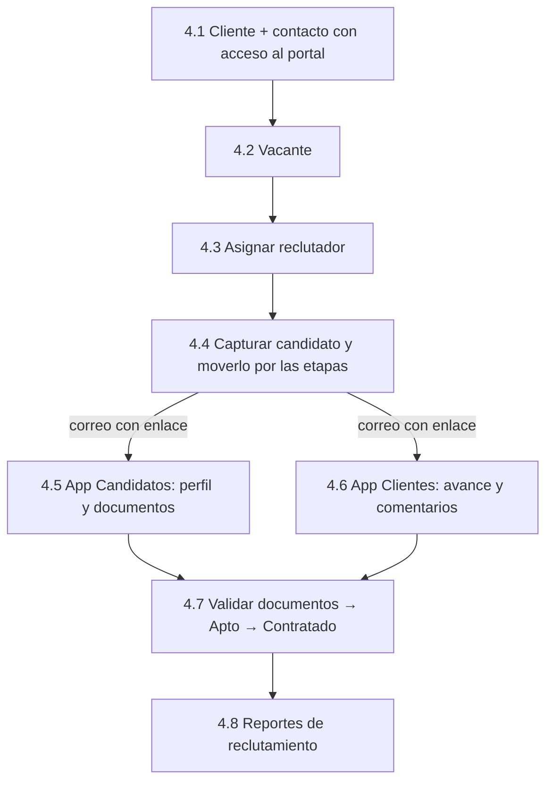
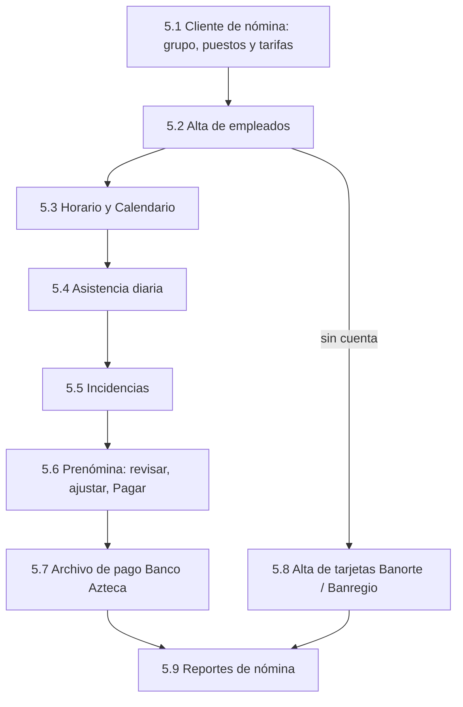

# GUÍA DE USO — Plataforma de Reclutamiento y Prenómina

> **Para:** Edgar Rodríguez y su equipo (pruebas de aceptación)
> **Ambiente:** DEV — los datos que capturen aquí son de prueba y pueden borrarse.
> **Versión:** 2026-11-02

Esta guía explica cómo usar la plataforma y, al mismo tiempo, sirve como lista de pruebas: cada paso dice **qué hacer**,
**qué debe aparecer** y tiene una casilla ☐ para marcarlo. Si algo no aparece como se describe, anótelo en la
[sección 7](#7-cómo-reportar-un-problema).

---

## Índice

1. [La plataforma en una página](#1-la-plataforma-en-una-página)
2. [Antes de empezar](#2-antes-de-empezar)
3. [Configuración inicial (una sola vez)](#3-configuración-inicial-una-sola-vez)
4. [Negocio 1 · Reclutamiento](#4-negocio-1--reclutamiento)
5. [Negocio 2 · Servicios profesionales / Nómina](#5-negocio-2--servicios-profesionales--nómina)
6. [Reglas importantes](#6-reglas-importantes)
7. [Cómo reportar un problema](#7-cómo-reportar-un-problema)
8. [Lista de verificación completa](#8-lista-de-verificación-completa)

---

## 1. La plataforma en una página

Una sola plataforma atiende **dos negocios distintos** de la misma empresa. Comparten la lista de clientes y el registro
de personas con sus documentos, pero **no se mezclan**: un candidato contratado en Reclutamiento es empleado **del
cliente**, no entra a la Nómina.

```mermaid
flowchart LR
  subgraph Admin["App Administración (equipo interno)"]
    R[Reclutamiento<br/>Vacantes · Candidatos · Reclutadores · Clientes · Reportes]
    N[Nómina<br/>Personal · Calendario · Asistencia · Incidencias · Prenómina · Clientes (nómina) · Reportes de nómina]
    A[Administración<br/>Usuarios · Catálogos]
  end
  C["App Candidatos<br/>Mi perfil · Mis documentos · Mi postulación"]
  K["App Clientes<br/>Mis vacantes · Comentarios"]
  R <-->|enlace por correo| C
  R <-->|enlace por correo · solo consulta| K
  N -->|archivos Excel| B[Portales bancarios<br/>Banco Azteca · Banorte · Banregio]
```

| App | Dirección (DEV) | Quién entra | Cómo entra |
|---|---|---|---|
| **Administración** | https://rass-project-2-admin.web.app | Dueño, administradores, reclutadores | Correo y contraseña (+ código de verificación en dos pasos si está activado) |
| **Candidatos** | https://rass-project-2-candidatos.web.app | Candidatos | Enlace que llega por correo (sin contraseña) |
| **Clientes** | https://rass-project-2-clientes.web.app | Contactos de los clientes | Enlace que llega por correo (sin contraseña) |

### Quién ve qué

| Rol | Qué puede hacer |
|---|---|
| **Administrador (dueño)** | Todo, incluidos Reportes y Usuarios. |
| **Administrador con permisos limitados** | Solo los módulos que el dueño le marque, y opcionalmente solo de un cliente (ej. «Asistencia de HFC»). |
| **Reclutador** | Solo sus vacantes y los candidatos de esas vacantes (*Mis vacantes*, *Mis candidatos*). |
| **Cliente** | Solo sus vacantes; ve a los candidatos con iniciales hasta que están *Apto*; nunca ve sueldo, sexo, edad ni documentos personales. |
| **Candidato** | Solo su propio perfil, sus documentos y el avance de su postulación. |

---

## 2. Antes de empezar

### 2.1 Lo que ya existe en DEV

El ambiente arranca **vacío**. Solo tiene:

- Su cuenta de dueño (Administrador con todos los permisos).
- Los catálogos de base: bancos, tipos de documento (INE, CURP, RFC, NSS, acta, comprobante de domicilio, …), las
  plantillas de expediente «Candidato — estándar» y «Empleado — expediente», zonas, niveles de estudio, prestaciones
  y los conceptos de nómina.

**No hay** clientes, vacantes, candidatos, empleados, días festivos ni semanas de nómina: todo eso lo crean ustedes
siguiendo esta guía.

### 2.2 Correos para las pruebas

Las apps de Candidatos y Clientes, y las invitaciones de usuarios, funcionan con enlaces que llegan **por correo**. Usen
correos reales a los que tengan acceso. Sugerencia: con Gmail, `sunombre+candidato1@gmail.com`,
`sunombre+cliente1@gmail.com`, etc. llegan todos al mismo buzón.

| Para | Correo sugerido |
|---|---|
| Usuario de prueba con permisos limitados | `…+asistencia@…` |
| Reclutador | `…+reclutador@…` |
| Contacto del cliente | `…+cliente1@…` |
| Candidato | `…+candidato1@…` |

> Los correos los envía `rass-project-2@website.rammalvarez.com`. Si no llegan, revisen *Spam* / *Promociones*.

### 2.3 Consejos

- Usen **Chrome** o **Edge** actualizados. Para entrar con dos usuarios a la vez, abran el segundo en una **ventana
  de incógnito**.
- El botón **«Actualizar»** de la barra superior trae los datos más recientes sin recargar la página.
- La campana 🔔 muestra avisos (documentos subidos, días sin captura, periodos en revisión).

---

## 3. Configuración inicial (una sola vez)

**Quién:** el dueño, en la App Administración.

### 3.1 Entrar

1. ☐ Abra la App Administración → **Entrar** con una contraseña equivocada → aparece el mensaje de error.
2. ☐ Entre con su correo y contraseña correctos → ve el menú lateral con **Reclutamiento**, **Nómina** y
   **Administración**.


### 3.2 Verificación en dos pasos (recomendado)

1. ☐ Menú de su nombre → **Mi perfil** → *Verificación en dos pasos* → **«Generar código QR»**.
2. ☐ Escanee el código con Google Authenticator / Microsoft Authenticator y escriba el código de 6 dígitos.
3. ☐ Guarde los **códigos de recuperación** en un lugar seguro.
4. ☐ Cierre sesión y vuelva a entrar → ahora le pide el código.


### 3.3 Catálogos

*Administración → Catálogos*

1. ☐ **Días festivos** → «Agregar festivos de ley 2026» → aparecen los festivos oficiales. (Repítalo con 2027.)
2. ☐ **Prestaciones** → agregue «Bono de asistencia» → aparece en la lista. Agregarla otra vez → «Ya existe una
   prestación con ese nombre.»
3. ☐ **Tipos de documento** → agregue «Constancia médica», marcando que vence, vigencia 365 días → aparece en la lista.


### 3.4 Usuarios y permisos

*Administración → Usuarios*

1. ☐ **«Invitar usuario»** → nombre «Prueba Asistencia», rol **Administrador**, deje marcado solo **Asistencia** →
   «Invitación enviada a …».
2. ☐ En una ventana de incógnito abra el correo de invitación → defina la contraseña → el menú muestra **solo**
   Calendario y Asistencia.
3. ☐ **«Invitar usuario»** → rol **Reclutador**, con el correo de reclutador → quien la reciba define su contraseña.
4. ☐ De vuelta como dueño: la lista muestra el último acceso de cada usuario.

> **Delegar permisos.** Así se da a una persona solo lo que necesita: por ejemplo «solo Prenómina de ECOVIA» o «solo
> archivos de pago». *Reportes de reclutamiento* queda, por omisión, solo para el dueño.


---

## 4. Negocio 1 · Reclutamiento



**Las etapas de un candidato:** Nuevo → Contactado → Entrevista → Apto / No apto → Contratado / Descartado.
*Contratado* es el **final** del proceso: la persona pasa a ser empleada del cliente.

### 4.1 Cliente

*Reclutamiento → Clientes*

1. ☐ **«Nuevo cliente»** → nombre corto, razón social, RFC, contacto principal y celular → «Cliente creado».
2. ☐ Pestaña **Sitios** → «Nuevo sitio» con zona y código postal → «Sitio guardado».
3. ☐ Pestaña **Contactos** → «Nuevo contacto» con el correo de cliente → **«Invitar al portal»** → el contacto queda
   «Con acceso al portal» y aparece como usuario Cliente en *Usuarios*.


### 4.2 Vacante

*Reclutamiento → Vacantes*

1. ☐ **«Nueva vacante»** → cliente, puesto (ej. Auxiliar de limpieza), número de vacantes: 2, sueldo, prestaciones
   (incluya «Bono de asistencia»), documentos requeridos, sexo y edad (estos dos son internos), marque **«Visible en el
   portal del cliente»** → «Vacante creada», estatus *Abierta*.
2. ☐ La vacante también aparece en la pestaña *Vacantes* del cliente.


### 4.3 Reclutador

*Reclutamiento → Reclutadores*

1. ☐ Abra al reclutador invitado en 3.4 → **«Asignar vacante»** → la vacante de 4.2 como **Líder**.
2. ☐ **«Ver como reclutador»** → ve la vacante en *Mis vacantes*, igual que la vería él → **«Salir»**.

### 4.4 Candidato

*Vacante → pestaña Pipeline*

1. ☐ **«Nuevo candidato»** → persona nueva con el correo de candidato, fuente, sueldo ofrecido → la tarjeta aparece en
   la columna **Nuevo** y la vacante pasa a *En proceso*. Al candidato le llega un correo «Tu postulación: …».
2. ☐ Arrastre la tarjeta a **Contactado** y luego a **Entrevista**.
3. ☐ Abra el perfil → pestaña **Entrevistas** → programe una entrevista con el reclutador.
4. ☐ Escriba una **nota** con una lista → aparece arriba de las notas (las notas son internas: ni el cliente ni el
   candidato las ven).


### 4.5 App Candidatos

**Quién:** el candidato, desde su celular o computadora.

1. ☐ Abra el enlace del correo → acepte el **aviso de privacidad** → entra a *Mi perfil*.
2. ☐ **Mi perfil:** CURP, RFC, NSS, celular, domicilio → Guardar. «Agregar mi cuenta» con una tarjeta de débito →
   se muestra como «•••• NNNN».
3. ☐ **Mis documentos:** suba INE (PDF) y comprobante de domicilio (JPG) → quedan *Entregado*.
4. ☐ **Mi postulación:** la vacante, la etapa actual y los datos de contacto del reclutador.


### 4.6 App Clientes

**Quién:** el contacto del cliente.

1. ☐ Abra el enlace del correo → **Mis vacantes** muestra la vacante **sin** sueldo, sexo ni edad.
2. ☐ Abra la vacante → el candidato aparece con **iniciales** (todavía no es Apto).
3. ☐ Escriba un comentario → aparece en la conversación y en **Comentarios**.


### 4.7 Cierre en Administración

1. ☐ El perfil del candidato muestra la CURP, RFC, domicilio y fecha de nacimiento que capturó en 4.5.
2. ☐ Documentos *Entregado* → **Validar** ambos → *Validado*. (Pruebe también **Rechazar** con un motivo: el candidato
   lo ve y puede volver a subirlo.)
3. ☐ La campana del reclutador tiene «… subió Identificación oficial».
4. ☐ Pestaña **Comentarios del cliente** → está el comentario de 4.6.
5. ☐ Mueva a **Apto** → recargue la App Clientes: ahora ve el nombre completo, sueldo ofrecido, entrevista y
   porcentaje de documentos.
6. ☐ **«Mover a Contratado»** con la fecha de ingreso de hoy → «… 1 de 2 cubiertas». Con el segundo contratado la
   vacante queda *Cubierta*.
7. ☐ El candidato contratado **no** tiene ningún botón para pasarlo a Nómina: su proceso termina aquí.

### 4.8 Reportes de reclutamiento

*Reclutamiento → Reportes* (solo dueño o quien tenga el permiso)

1. ☐ **Rendimiento por reclutador** → el reclutador con su vacante, presentados, aptos, contratados.
2. ☐ **Resumen de reclutamiento** → cuenta las vacantes y candidatos capturados.
3. ☐ **«Exportar Excel»** descarga el reporte.


---

## 5. Negocio 2 · Servicios profesionales / Nómina



> **Importante:** la Nómina se alimenta **solo** con «Alta de empleado». Los candidatos de Reclutamiento no pasan aquí.

### 5.1 Cliente de nómina

*Nómina → Clientes (nómina)*

1. ☐ Abra el cliente (el mismo de 4.1 o uno nuevo creado en *Reclutamiento → Clientes*) → **«Nuevo grupo»**: nombre,
   período **Semanal**, día de corte **Domingo**, horas por turno, hora de cierre de asistencia → «Grupo … guardado».
2. ☐ **«Nuevo puesto»** con sus tarifas (SD bolsillo, SD IMSS, costo por hora, bono) → «Puesto guardado».
3. ☐ **Bonos y conceptos** → active los que apliquen → «Conceptos guardados».
4. ☐ La lista «Clientes con proyectos activos» muestra el cliente con sus grupos y puestos.


### 5.2 Alta de empleados

*Nómina → Personal*

1. ☐ **«Alta de empleado»** → persona nueva (nombre, CURP, celular), grupo y puesto del paso 5.1, turno, fecha de
   ingreso hace una semana, **con una cuenta CLABE** → se abre el detalle del empleado.
2. ☐ Segunda **«Alta de empleado»** **sin cuenta** → elija «Solicitar tarjeta» Banorte → en la lista aparece
   «Tarjeta solicitada · Banorte».
3. ☐ Dé de alta 2 o 3 empleados más para tener una cuadrilla de prueba.


### 5.3 Horario, estatus y Calendario

1. ☐ En el primer empleado → pestaña **Horario** → un horario semanal en el sitio del cliente.
2. ☐ **«Cambiar estatus»** → *Vacaciones* de mañana a pasado mañana → la etiqueta «Vacaciones · dd/mm – dd/mm».
   (**Reactivar** las quita.)
3. ☐ *Nómina → Calendario* → vista semana / día / mes muestra el horario y las vacaciones.


### 5.4 Asistencia diaria

*Nómina → Asistencia*

1. ☐ Elija hoy y el sitio → **«Todos presentes»** → marque a una persona con **Falta** → **Guardar** →
   «Asistencia guardada · n persona(s)».
2. ☐ Después de la hora de cierre del grupo el día dice «Este día ya cerró». Para corregirlo: **«Cambiar»** en una
   persona, con un motivo → «Día corregido: el cambio quedó registrado».
3. ☐ Entre como el usuario «Prueba Asistencia» (3.4): solo ve Calendario y Asistencia.

> **Regla del negocio:** si un día no se captura, la persona **no trabajó**. Los días cerrados solo se corrigen con
> motivo, y queda registrado quién y por qué.


### 5.5 Incidencias

*Nómina → Incidencias*

1. ☐ **«Nueva incidencia»** → *Tiempo extra doble*, 2 horas, a un empleado de la semana actual → aparece en la lista.
2. ☐ Otra: un **Descuento** → aparece en la lista.

### 5.6 Prenómina

*Nómina → Prenómina*

La semana aparece sola en cuanto hay asistencia capturada en ella.

1. ☐ Elija el grupo y la semana actual → la tabla con una fila por empleado; la fila del tiempo extra refleja la
   incidencia de 5.5 y la falta de 5.4.
2. ☐ Haga clic en una celda de SUELDO → **desglose** del cálculo → **«Ajustar celda»** con un motivo → el total cambia
   exactamente por la diferencia.
3. ☐ **Excel** descarga la prenómina.
4. ☐ Cuando la semana cierra queda *En revisión* → **«Pagar»** → **«Generar archivos de pago»** → la semana queda
   *Pagada* y se descarga el archivo de **Banco Azteca**.
5. ☐ Después de subirlo al portal del banco → **«Marcar subido al banco»**.


> Para probar el pago sin esperar a que cierre la semana, capture asistencia de la **semana pasada** el primer día de
> pruebas.

### 5.7 Alta de tarjetas (Banorte / Banregio)

*Prenómina → Tarjetas*

1. ☐ **Por solicitar** → Banorte → el empleado sin cuenta de 5.2 → sucursal → **«Revisar»** lista lo que el banco pide
   (CURP, correo, calle, número, colonia, CP, RFC; la calle sin signos de puntuación).
2. ☐ **«Corregir en Personal»** → Persona → «Editar» → complete los datos → «Datos actualizados» → «Revisar» ya sale
   limpio.
3. ☐ **«Generar alta»** → «Alta Banorte generada: 1 persona» y se descarga el archivo.
4. ☐ **Lotes** → «Marcar subido al banco» → **«Tarjeta recibida»** con un número válido de 16 dígitos → «… la tarjeta
   ·NNNN es su cuenta principal».


### 5.8 Reportes de nómina

*Nómina → Reportes de nómina*

1. ☐ **Costo de nómina** → la semana pagada con el mismo total que la prenómina.
2. ☐ **Rotación** → las altas de 5.2.
3. ☐ **Tarjetas y cuentas** → la tarjeta de 5.7.
4. ☐ Cada reporte se descarga en Excel y PDF con las mismas cifras de la pantalla.


---

## 6. Reglas importantes

| Tema | Regla |
|---|---|
| **Dos negocios** | Reclutamiento y Nómina están separados. Un contratado es empleado del cliente; en Nómina solo hay «Alta de empleado». |
| **Una persona, un registro** | Si alguien ya existe (misma CURP o RFC), la plataforma lo encuentra y no lo duplica, en cualquiera de los dos negocios. |
| **Asistencia** | Se captura diario; lo no capturado cuenta como no trabajado; los días cerrados se corrigen con motivo. |
| **Cuentas bancarias** | Se guardan cifradas; en pantalla solo se ven los últimos 4 dígitos. |
| **Lo que ve el cliente** | Nunca sueldo, sexo, edad ni documentos personales; el nombre completo solo desde *Apto*. |
| **Bancos** | La plataforma genera los archivos en el formato de cada banco; subirlos al portal bancario lo hace una persona. |
| **Reportes** | *Reportes de reclutamiento* solo para quien el dueño autorice. |
| **Pantallas pequeñas** | Todas las apps funcionan en celular. |

---

## 7. Cómo reportar un problema

Por cada problema envíen:

1. **App y pantalla** (ej. «Administración → Prenómina»).
2. **Qué hicieron** (el número de paso de esta guía ayuda mucho, ej. «5.6 paso 2»).
3. **Qué esperaban** y **qué pasó**.
4. **Captura de pantalla** y la hora aproximada.

---

## 8. Lista de verificación completa

| # | Sección | Resultado | Notas |
|---|---|---|---|
| 3.1 | Entrar | ☐ OK ☐ Falla | |
| 3.2 | Verificación en dos pasos | ☐ OK ☐ Falla | |
| 3.3 | Catálogos | ☐ OK ☐ Falla | |
| 3.4 | Usuarios y permisos | ☐ OK ☐ Falla | |
| 4.1 | Cliente | ☐ OK ☐ Falla | |
| 4.2 | Vacante | ☐ OK ☐ Falla | |
| 4.3 | Reclutador | ☐ OK ☐ Falla | |
| 4.4 | Candidato | ☐ OK ☐ Falla | |
| 4.5 | App Candidatos | ☐ OK ☐ Falla | |
| 4.6 | App Clientes | ☐ OK ☐ Falla | |
| 4.7 | Cierre en Administración | ☐ OK ☐ Falla | |
| 4.8 | Reportes de reclutamiento | ☐ OK ☐ Falla | |
| 5.1 | Cliente de nómina | ☐ OK ☐ Falla | |
| 5.2 | Alta de empleados | ☐ OK ☐ Falla | |
| 5.3 | Horario, estatus y Calendario | ☐ OK ☐ Falla | |
| 5.4 | Asistencia diaria | ☐ OK ☐ Falla | |
| 5.5 | Incidencias | ☐ OK ☐ Falla | |
| 5.6 | Prenómina | ☐ OK ☐ Falla | |
| 5.7 | Alta de tarjetas | ☐ OK ☐ Falla | |
| 5.8 | Reportes de nómina | ☐ OK ☐ Falla | |
